# Hacker Wei queue

**13 waiting to post** (one goes out each day, lowest number first). 3 posted or skipped so far.

To stop a carousel from posting, delete its files in the `posts` folder before its day comes.

## Waiting

### Carousel 002

<a href="posts/002_1.jpg"></a> <a href="posts/002_2.jpg"></a> <a href="posts/002_3.jpg"></a> <a href="posts/002_4.jpg">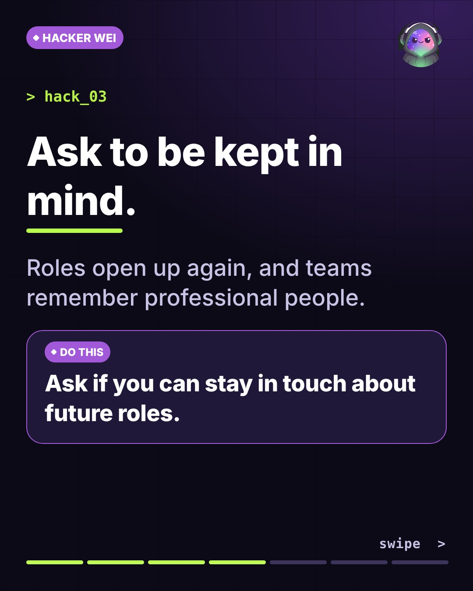</a> <a href="posts/002_5.jpg">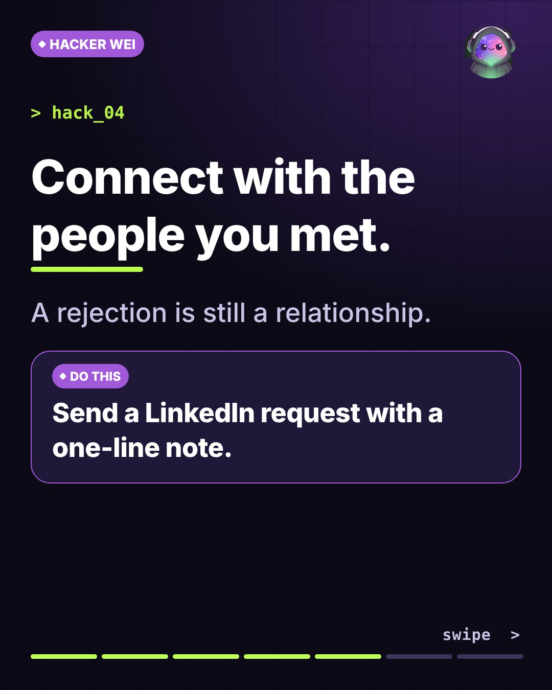</a> <a href="posts/002_6.jpg">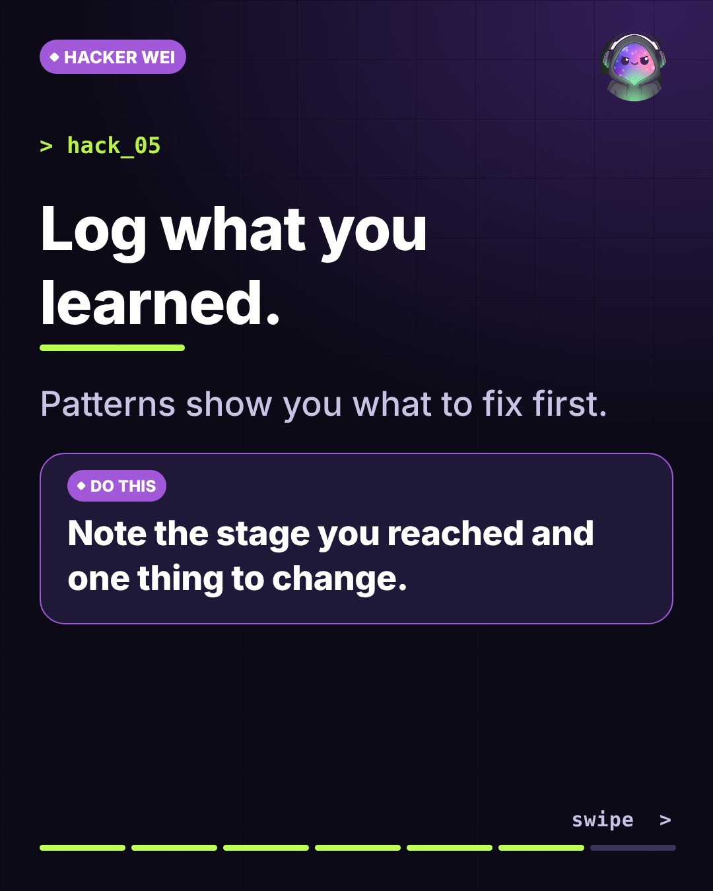</a> <a href="posts/002_7.jpg"></a>

<details><summary>Caption</summary>

```
A rejection is not the end. It can be a lead. 💡

5 moves that turn a no into a lead:
1. Reply within 24 hours
2. Ask for feedback
3. Ask to be kept in mind
4. Connect with the people you met
5. Log what you learned

Which one will you try? Comment the number 👇
Send this to a friend who needs it today.

#rejection #jobrejection #ukgraduate #graduatejobs #jobsearch #careeradvice #ukstudents #graduatelife #motivation #hackerwei
```

</details>

### Carousel 004

<a href="posts/004_1.jpg"></a> <a href="posts/004_2.jpg"></a> <a href="posts/004_3.jpg"></a> <a href="posts/004_4.jpg">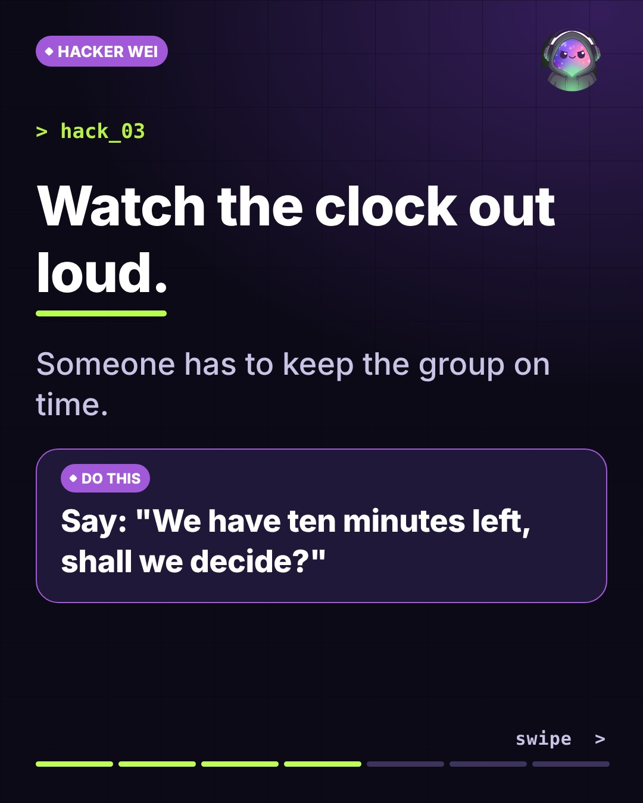</a> <a href="posts/004_5.jpg"></a> <a href="posts/004_6.jpg"></a> <a href="posts/004_7.jpg">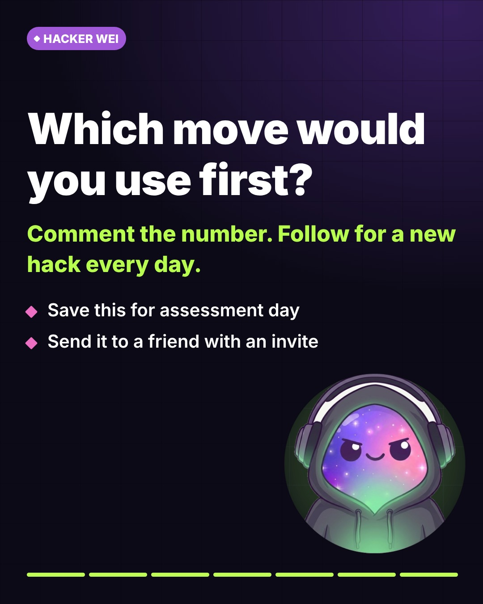</a>

<details><summary>Caption</summary>

```
Assessment centres are a team sport. Here is how to stand out without being the loudest in the room. 🏆

5 group exercise moves:
1. Speak early, not loudly
2. Bring the quiet person in
3. Watch the clock out loud
4. Credit other people's ideas
5. Summarise at the end

Which move would you use first? Comment the number 👇
Save this for assessment day.

#assessmentcentre #graduatescheme #groupexercise #ukgraduate #interviewtips #graduatejobs #ukstudents #careeradvice #jobinterview #hackerwei
```

</details>

### Carousel 006

<a href="posts/006_1.jpg"></a> <a href="posts/006_2.jpg">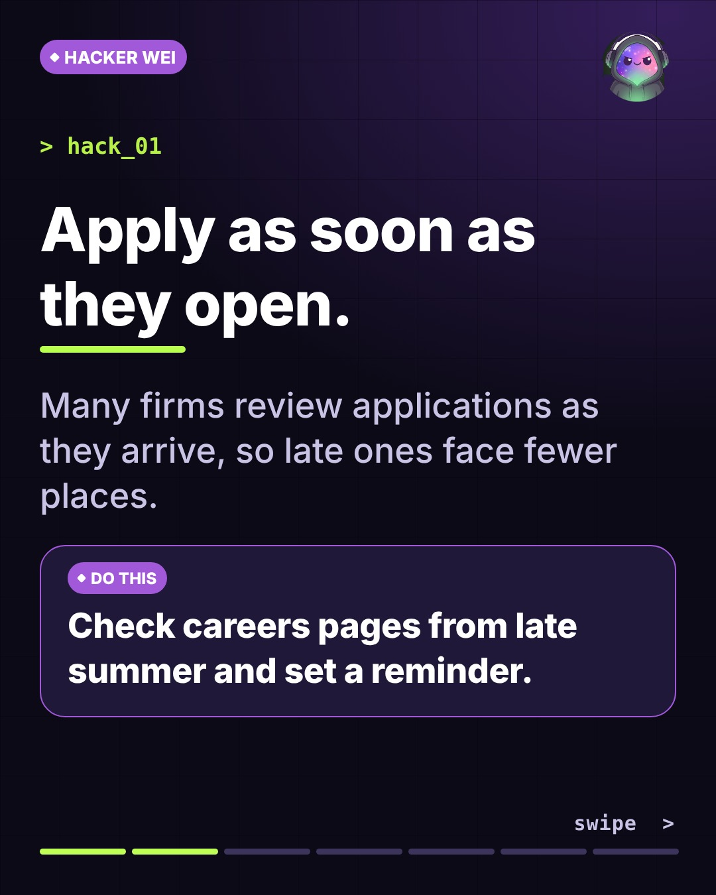</a> <a href="posts/006_3.jpg"></a> <a href="posts/006_4.jpg">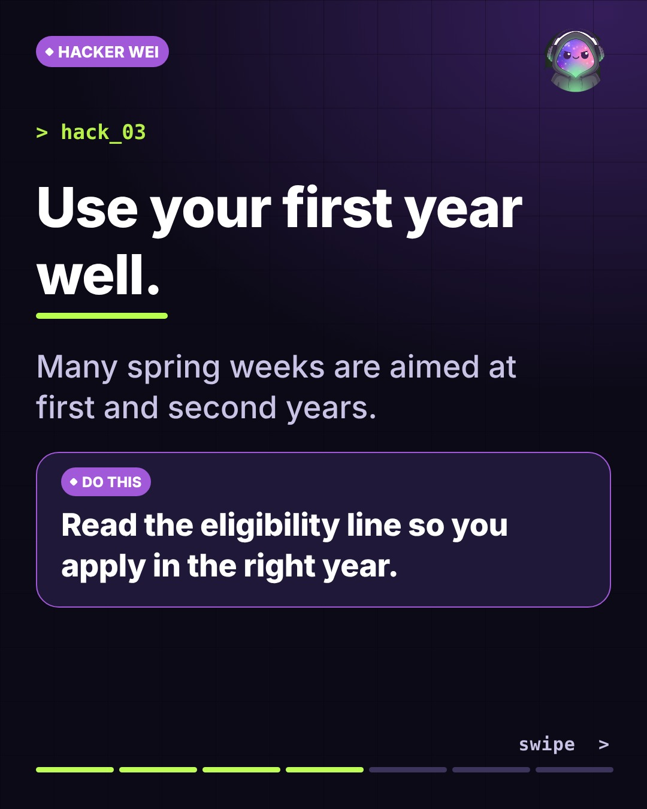</a> <a href="posts/006_5.jpg"></a> <a href="posts/006_6.jpg">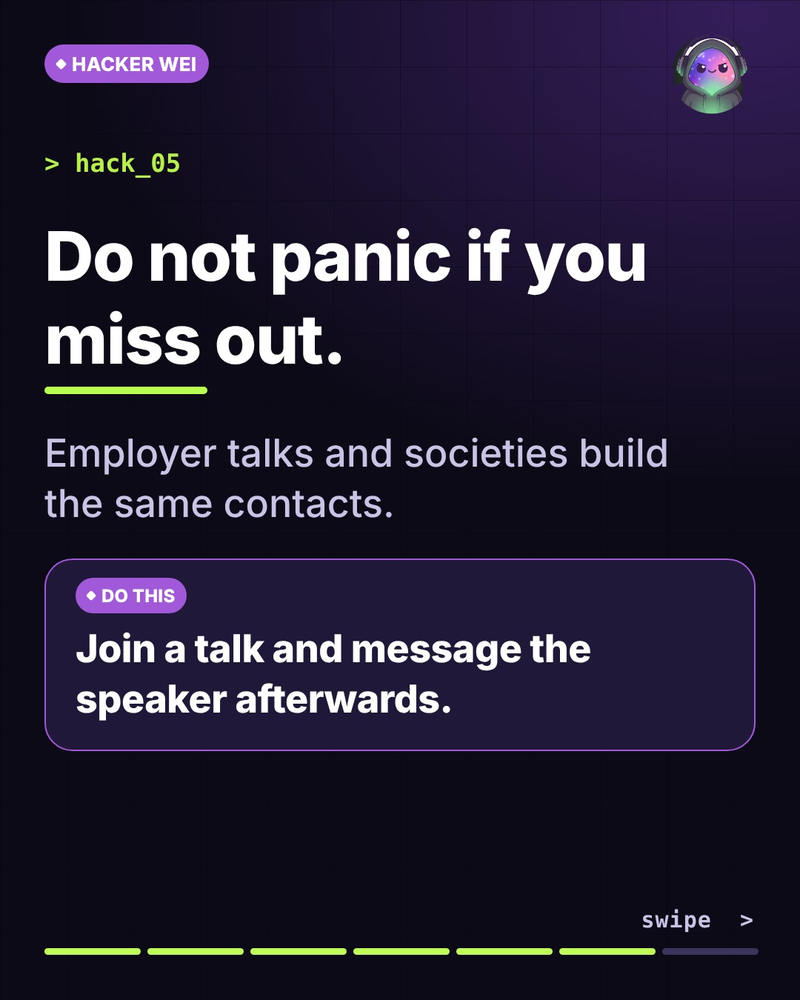</a> <a href="posts/006_7.jpg"></a>

<details><summary>Caption</summary>

```
Spring weeks fill up early. Here is how to get ahead of it. 🌱

5 ways to land one:
1. Apply as soon as they open
2. Look beyond the big names
3. Use your first year well
4. Show interest in one sentence
5. Do not panic if you miss out

Which one are you doing first? Comment the number 👇
Save this for September and send it to a first year.

#springweek #springweeks #insightday #ukstudents #firstyear #graduatejobs #internships #careeradvice #ukuniversity #hackerwei
```

</details>

### Carousel 007

<a href="posts/007_1.jpg"></a> <a href="posts/007_2.jpg"></a> <a href="posts/007_3.jpg"></a> <a href="posts/007_4.jpg"></a> <a href="posts/007_5.jpg"></a> <a href="posts/007_6.jpg"></a> <a href="posts/007_7.jpg"></a>

<details><summary>Caption</summary>

```
Your cover letter is judged in the first line. Make it count. ✍️

5 fixes for a stronger one:
1. Skip "I am writing to apply"
2. Match one need from the advert
3. Tell one short story
4. Keep it to one page
5. End with a clear next step

Which fix is hardest for you? Comment the number 👇
Save this for your next letter.

#coverletter #coverlettertips #jobapplication #ukgraduate #graduatejobs #ukstudents #careeradvice #jobsearchuk #cvtips #hackerwei
```

</details>

### Carousel 008

<a href="posts/008_1.jpg"></a> <a href="posts/008_2.jpg">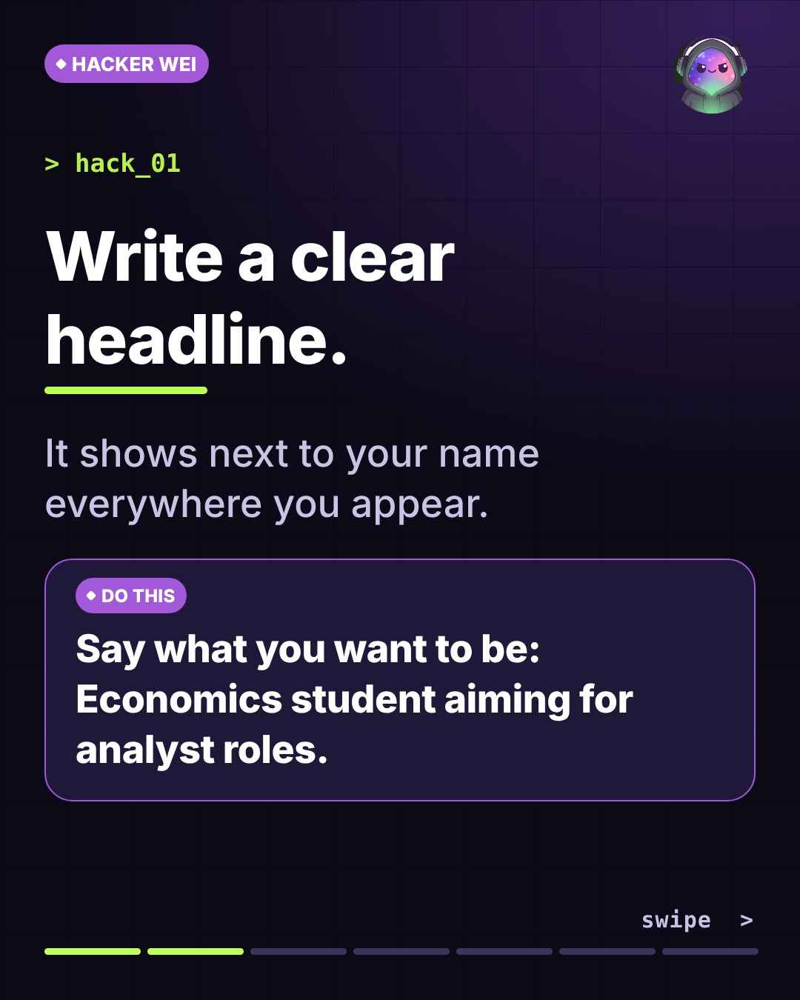</a> <a href="posts/008_3.jpg"></a> <a href="posts/008_4.jpg"></a> <a href="posts/008_5.jpg"></a> <a href="posts/008_6.jpg"></a> <a href="posts/008_7.jpg"></a>

<details><summary>Caption</summary>

```
Ten minutes is enough to make your LinkedIn work harder. 🔧

5 quick wins:
1. Write a clear headline
2. Add a clear, friendly photo
3. Write About in plain English
4. Turn on Open to work
5. Add the skills from job ads

Which quick win did you skip? Comment the number 👇
Save this for tonight and send it to a friend with a blank profile.

#linkedin #linkedintips #linkedinprofile #ukgraduate #graduatejobs #ukstudents #careeradvice #jobhunting #personalbranding #hackerwei
```

</details>

### Carousel 009

<a href="posts/009_1.jpg"></a> <a href="posts/009_2.jpg">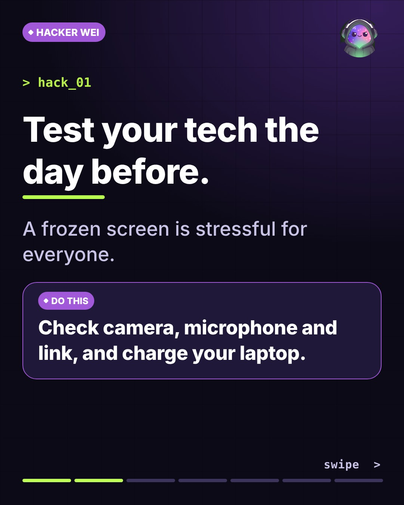</a> <a href="posts/009_3.jpg"></a> <a href="posts/009_4.jpg"></a> <a href="posts/009_5.jpg"></a> <a href="posts/009_6.jpg"></a> <a href="posts/009_7.jpg"></a>

<details><summary>Caption</summary>

```
Video interviews are won in the setup. 🎥

5 things to check first:
1. Test your tech the day before
2. Put the light in front of you
3. Look at the camera, not the screen
4. Keep notes where you can see them
5. Close tabs and silence notifications

Which one would you forget? Comment the number 👇
Save this before your interview.

#videointerview #interviewtips #zoominterview #ukgraduate #graduatejobs #ukstudents #careeradvice #jobinterview #interviewprep #hackerwei
```

</details>

### Carousel 010

<a href="posts/010_1.jpg"></a> <a href="posts/010_2.jpg"></a> <a href="posts/010_3.jpg">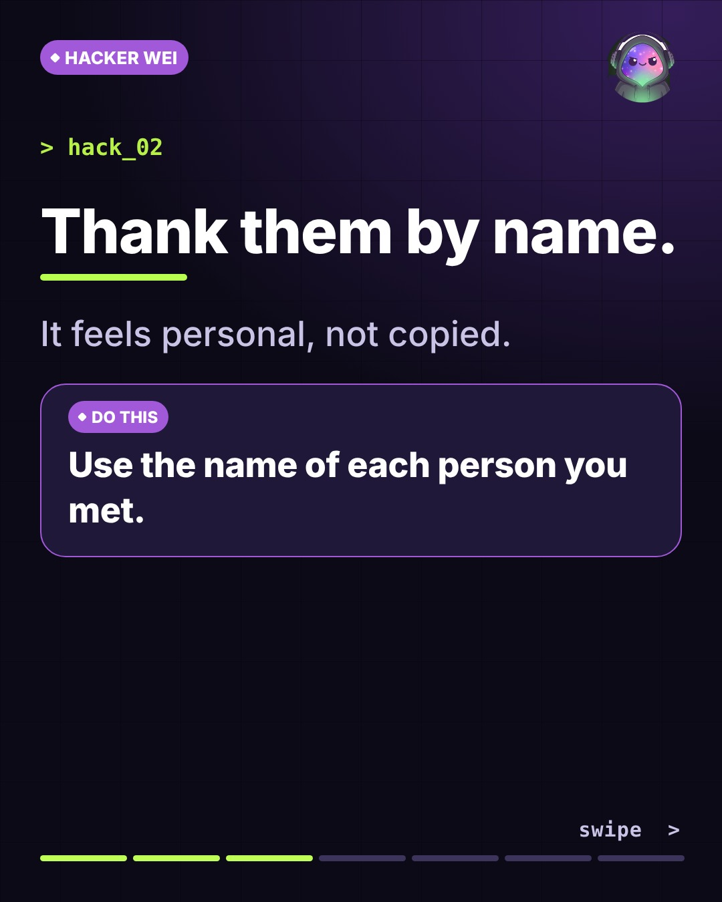</a> <a href="posts/010_4.jpg"></a> <a href="posts/010_5.jpg">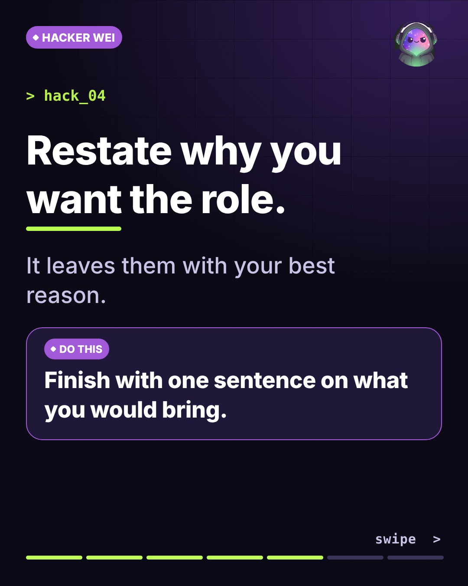</a> <a href="posts/010_6.jpg"></a> <a href="posts/010_7.jpg">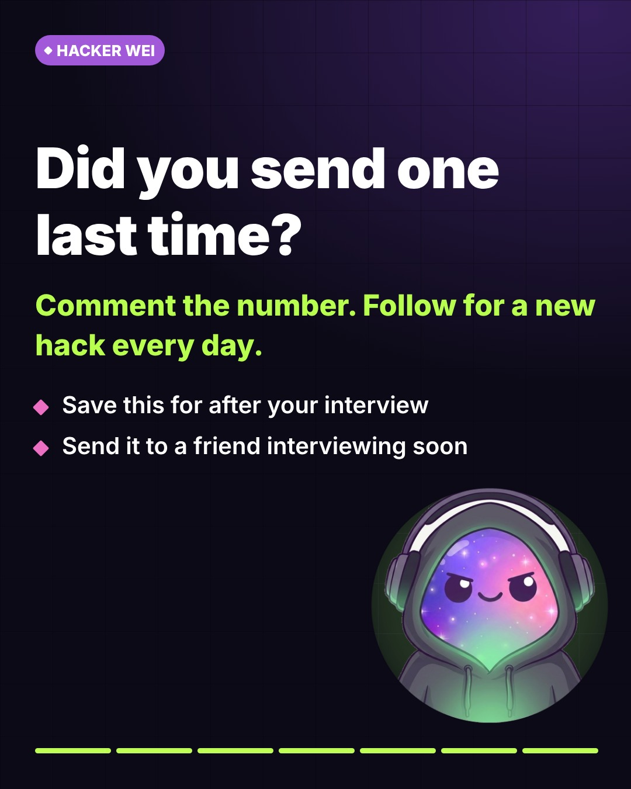</a>

<details><summary>Caption</summary>

```
The email after your interview matters more than you think. 📧

5 lines that help you stand out:
1. Send it within 24 hours
2. Thank them by name
3. Mention one thing you discussed
4. Restate why you want the role
5. Keep it short and warm

Did you send one last time? Comment the number 👇
Save this for after your interview.

#thankyouemail #interviewtips #followup #ukgraduate #graduatejobs #ukstudents #careeradvice #jobinterview #jobsearchuk #hackerwei
```

</details>

### Carousel 012

<a href="posts/012_1.jpg"></a> <a href="posts/012_2.jpg"></a> <a href="posts/012_3.jpg"></a> <a href="posts/012_4.jpg"></a> <a href="posts/012_5.jpg"></a> <a href="posts/012_6.jpg"></a> <a href="posts/012_7.jpg">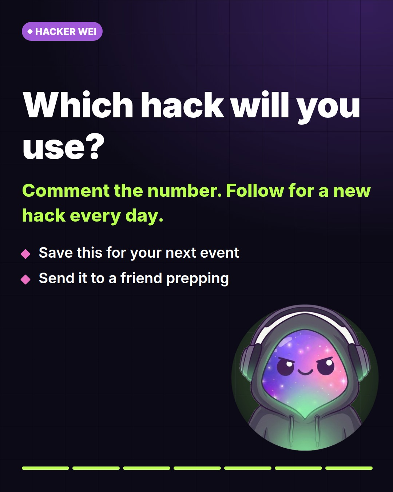</a>

<details><summary>Caption</summary>

```
Case studies at assessment centres are meant to test your thinking under pressure. Here is how to keep your cool.

5 hacks to stay clear:
1. Read the prompt twice
2. Prioritise the facts first
3. Manage your time strictly
4. Be ready to justify why
5. Stay focused on the prompt

Which hack will you use? Comment the number 👇
Save this and follow for a new hack every day.

#ukgraduate #graduatejobs #ukstudents #careeradvice #jobsearch #assessmentcentre #casestudy #interviewprep #jobinterview #hackerwei
```

</details>

### Carousel 013

<a href="posts/013_1.jpg">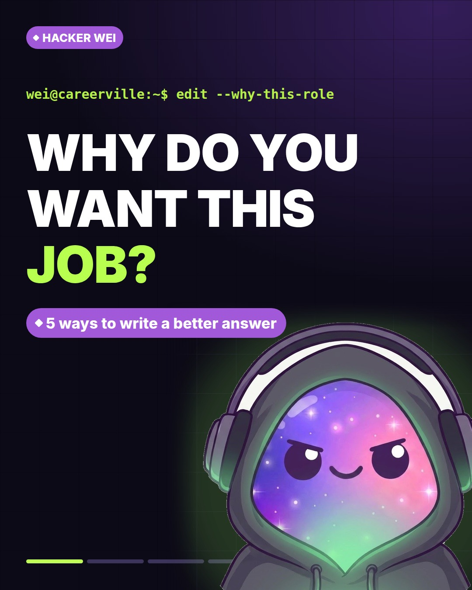</a> <a href="posts/013_2.jpg"></a> <a href="posts/013_3.jpg"></a> <a href="posts/013_4.jpg"></a> <a href="posts/013_5.jpg"></a> <a href="posts/013_6.jpg"></a> <a href="posts/013_7.jpg"></a>

<details><summary>Caption</summary>

```
Stop copying and pasting your motivation answers. Here is how to write a genuine response that actually gets noticed.

5 ways to write a better answer:
1. State your spark immediately
2. Link to their current projects
3. Connect your values to theirs
4. Keep the focus on them
5. Review your own examples

Which one will you try? Comment the number 👇
Save this and follow for a new hack every day.

#ukgraduate #graduatejobs #ukstudents #careeradvice #jobhunt #coverletter #applicationtips #jobapplication #graduatescheme #hackerwei
```

</details>

### Carousel 014

<a href="posts/014_1.jpg">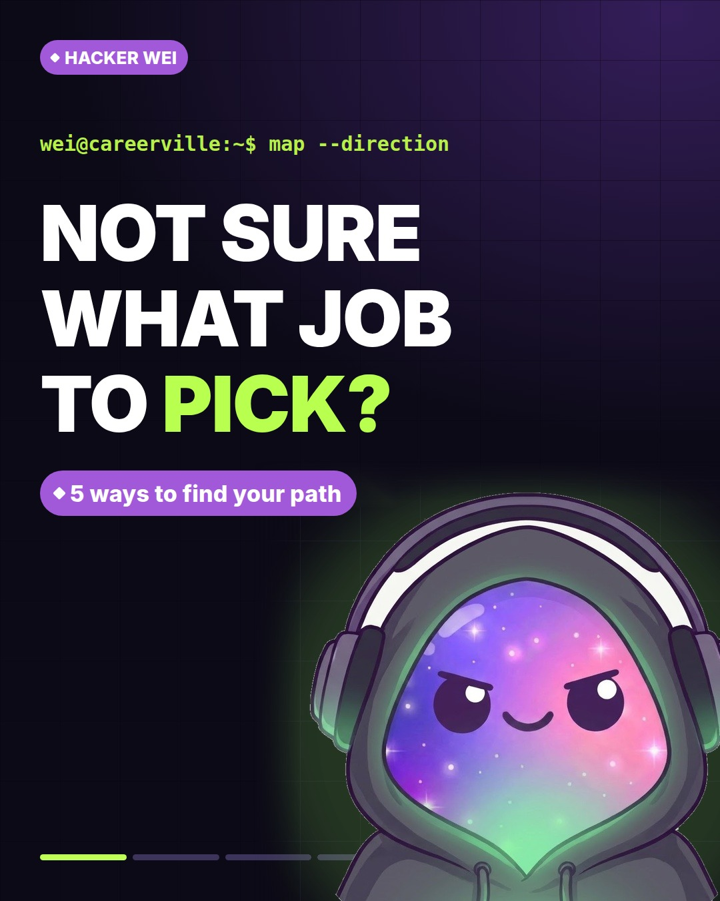</a> <a href="posts/014_2.jpg"></a> <a href="posts/014_3.jpg">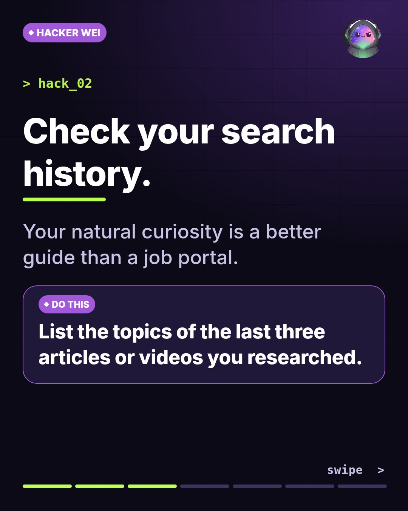</a> <a href="posts/014_4.jpg"></a> <a href="posts/014_5.jpg"></a> <a href="posts/014_6.jpg"></a> <a href="posts/014_7.jpg"></a>

<details><summary>Caption</summary>

```
Feeling lost after graduation is normal. Stop overthinking and start testing your way to a clear answer.

5 ways to find your path:
1. List your daily non negotiables
2. Check your search history
3. Shadow a professional for a day
4. Match your skills to sectors
5. Talk to a recent graduate

Which step will you try? Comment the number 👇
Save this and follow for a new hack every day.

#ukgraduate #graduatejobs #ukstudents #careeradvice #jobsearchuk #careergoals #careertips #graduatescheme #studentlife #hackerwei
```

</details>

### Carousel 015

<a href="posts/015_1.jpg">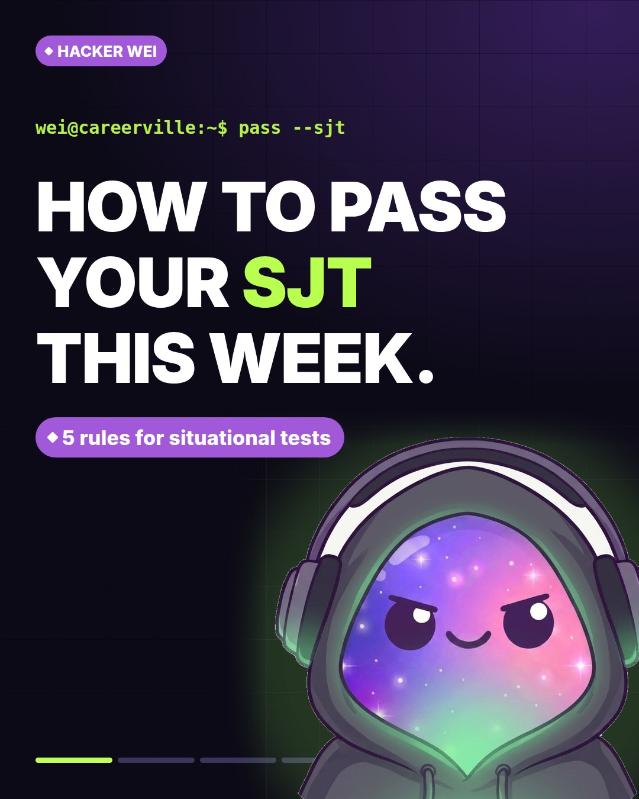</a> <a href="posts/015_2.jpg"></a> <a href="posts/015_3.jpg"></a> <a href="posts/015_4.jpg">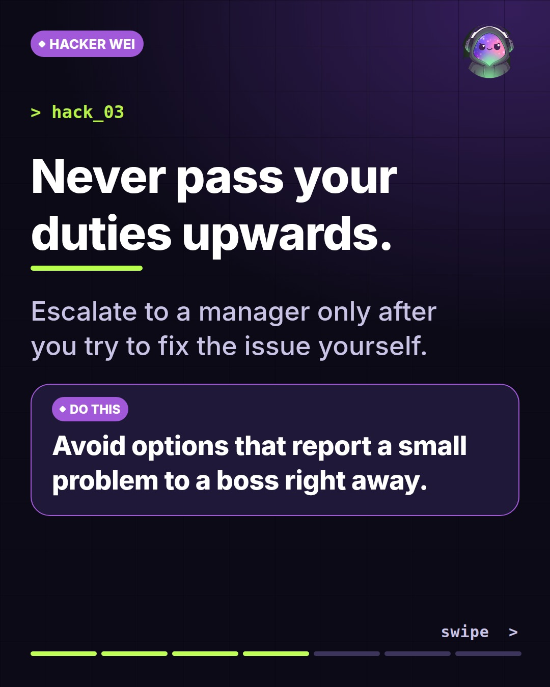</a> <a href="posts/015_5.jpg"></a> <a href="posts/015_6.jpg">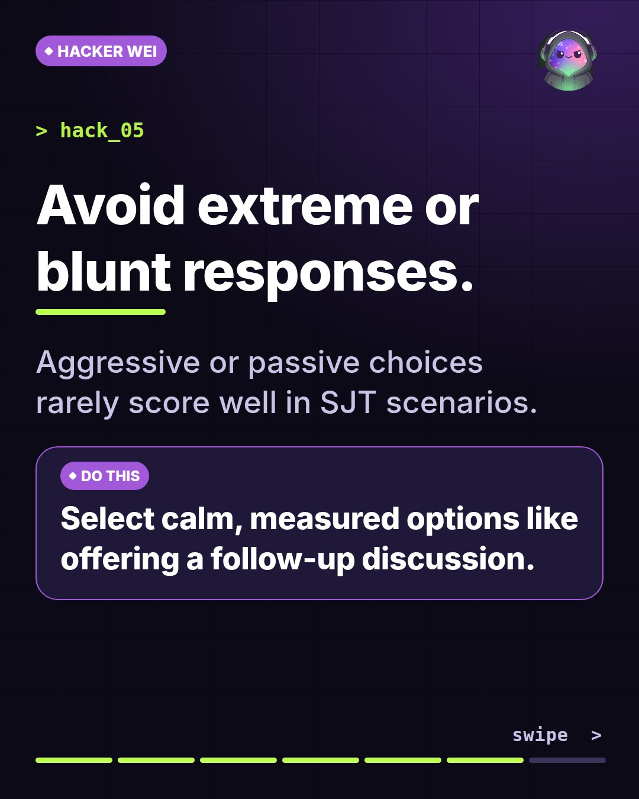</a> <a href="posts/015_7.jpg"></a>

<details><summary>Caption</summary>

```
Situational judgement tests can feel confusing. Here is how to pick the right answers and pass your next assessment.

5 rules for situational tests:
1. Put team goals before your own
2. Address issues directly and early
3. Never pass your duties upwards
4. Align choices with company values
5. Avoid extreme or blunt responses

Which rule will you use? Comment the number 👇
Save this and follow for a new hack every day.

#ukgraduate #graduatejobs #ukstudents #careeradvice #jobhunting #sjt #onlineassessment #psychometric #gradschemes #hackerwei
```

</details>

### Carousel 016

<a href="posts/016_1.jpg"></a> <a href="posts/016_2.jpg"></a> <a href="posts/016_3.jpg"></a> <a href="posts/016_4.jpg"></a> <a href="posts/016_5.jpg"></a> <a href="posts/016_6.jpg"></a> <a href="posts/016_7.jpg"></a>

<details><summary>Caption</summary>

```
Worked in retail or at a bar? Here is how to make your part-time uni job look impressive on a graduate CV.

5 ways to upgrade part-time work:
1. Lead with transferable skills
2. Show the scale of your work
3. Show trust and responsibility
4. Start bullets with action verbs
5. Link your duties to the role

Which tip helps you most? Comment the number 👇
Save this and follow for a new hack every day.

#ukgraduate #graduatejobs #ukstudents #careeradvice #jobhunting #cvtips #parttimejob #cvhelp #studentcv #hackerwei
```

</details>

### Carousel 017

<a href="posts/017_1.jpg"></a> <a href="posts/017_2.jpg">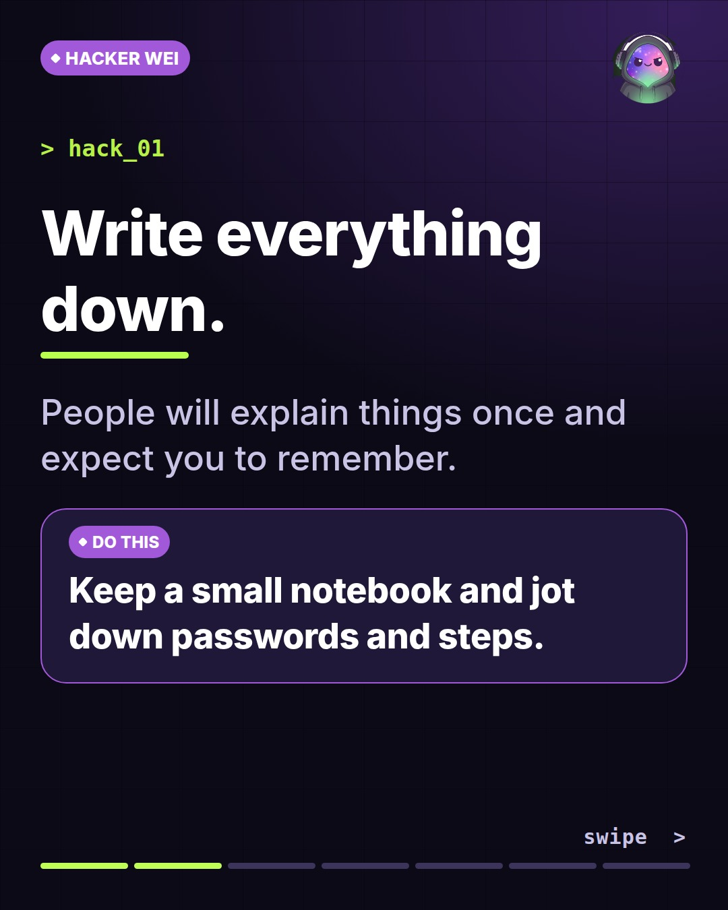</a> <a href="posts/017_3.jpg"></a> <a href="posts/017_4.jpg">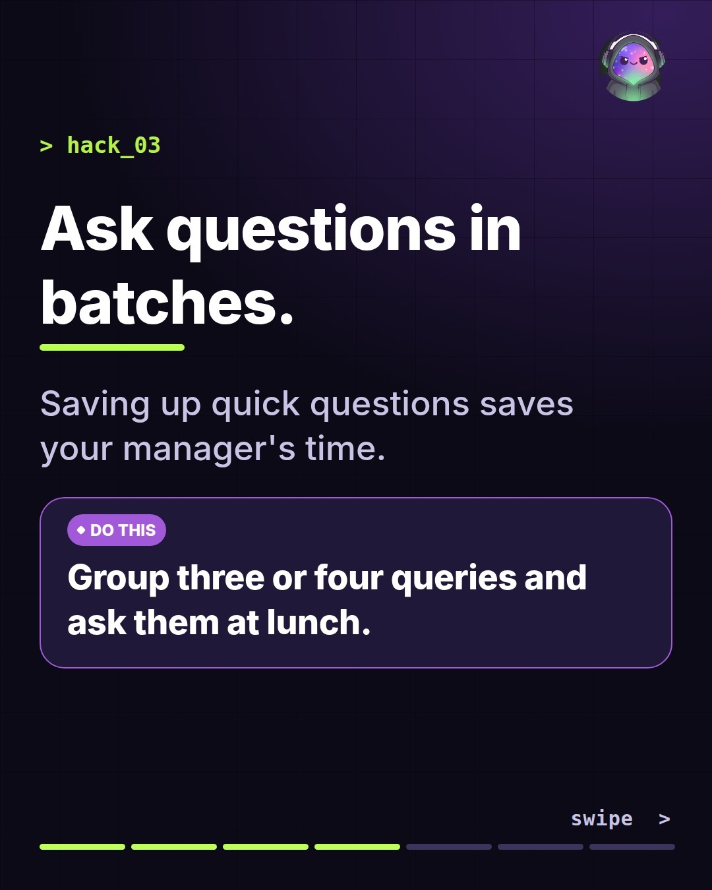</a> <a href="posts/017_5.jpg">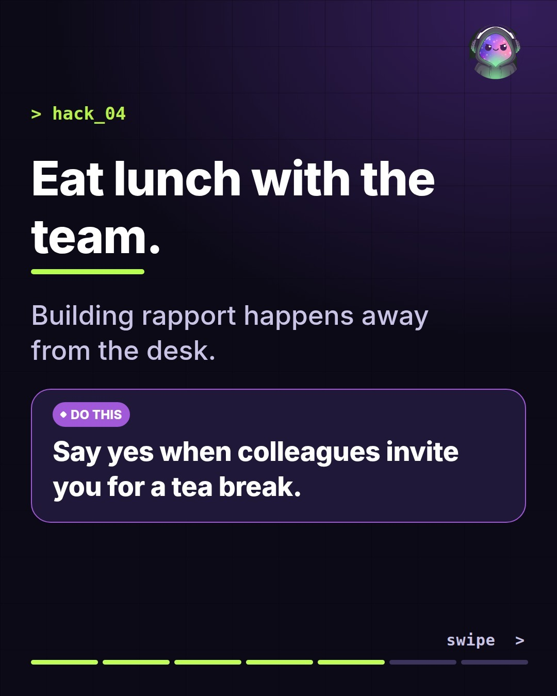</a> <a href="posts/017_6.jpg"></a> <a href="posts/017_7.jpg"></a>

<details><summary>Caption</summary>

```
Starting your first job can feel overwhelming. Here is how to nail your first week.

5 habits that make you look pro:
1. Write everything down
2. Set up your tech early
3. Ask questions in batches
4. Eat lunch with the team
5. Send a Friday recap

Which habit will you start? Comment the number 👇
Save this and follow for a new hack every day.

#ukgraduate #graduatejobs #ukstudents #careeradvice #jobhunting #graduatelife #firstjob #graduatescheme #officeetiquette #hackerwei
```

</details>


## Recently posted

- Carousel 005: manual
- Carousel 003: manual
- Carousel 001: 2026-11-18
