# Posting queue

Vault posts (added by hand) go first, then the AI-written queue. To stop a post, delete its files before its slot comes.

## Hacker Wei

**12 waiting** (1 from the vault). 6 posted by the system so far.

### vault/20261120-1730-tt-carousel-cv-7seconds

<a href="vault/hacker/20261120-1730-tt-carousel-cv-7seconds_1.jpg">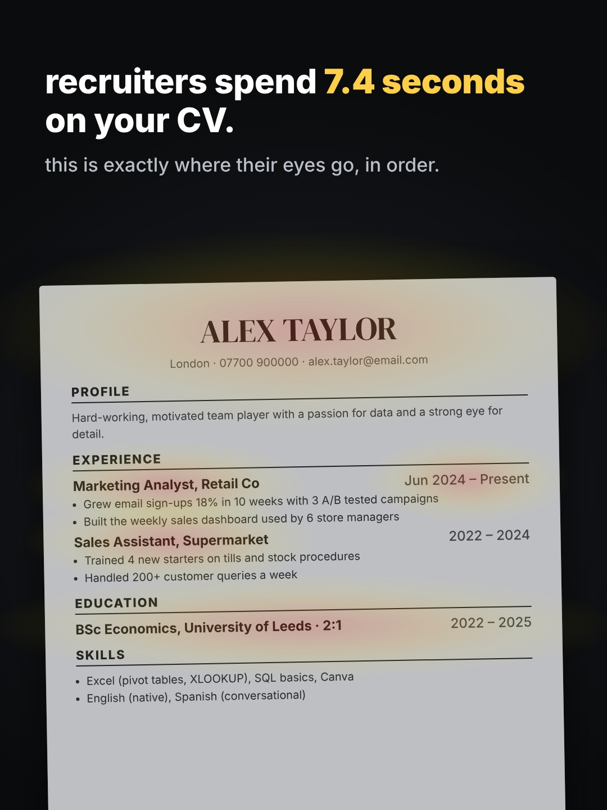</a> <a href="vault/hacker/20261120-1730-tt-carousel-cv-7seconds_2.jpg"></a> <a href="vault/hacker/20261120-1730-tt-carousel-cv-7seconds_3.jpg"></a> <a href="vault/hacker/20261120-1730-tt-carousel-cv-7seconds_4.jpg"></a> <a href="vault/hacker/20261120-1730-tt-carousel-cv-7seconds_5.jpg"></a> <a href="vault/hacker/20261120-1730-tt-carousel-cv-7seconds_6.jpg">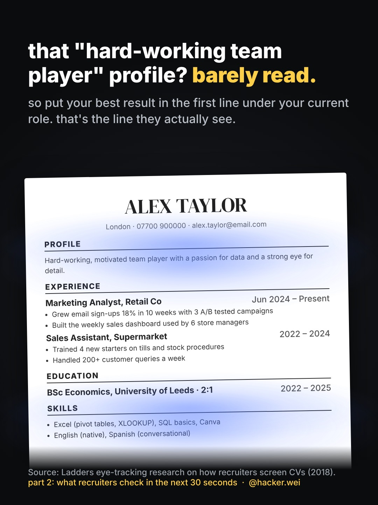</a>

<details><summary>Caption</summary>

```
where recruiters actually look on your cv, in order

#cvtips #recruiter #jobsearch #graduatejobs #careeradvice #ukjobs
```

</details>

### 008

<a href="posts/008_1.jpg">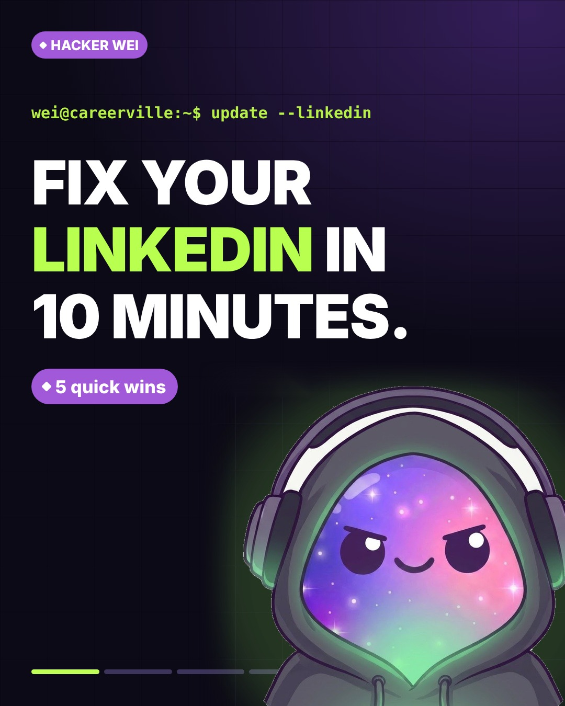</a> <a href="posts/008_2.jpg"></a> <a href="posts/008_3.jpg"></a> <a href="posts/008_4.jpg">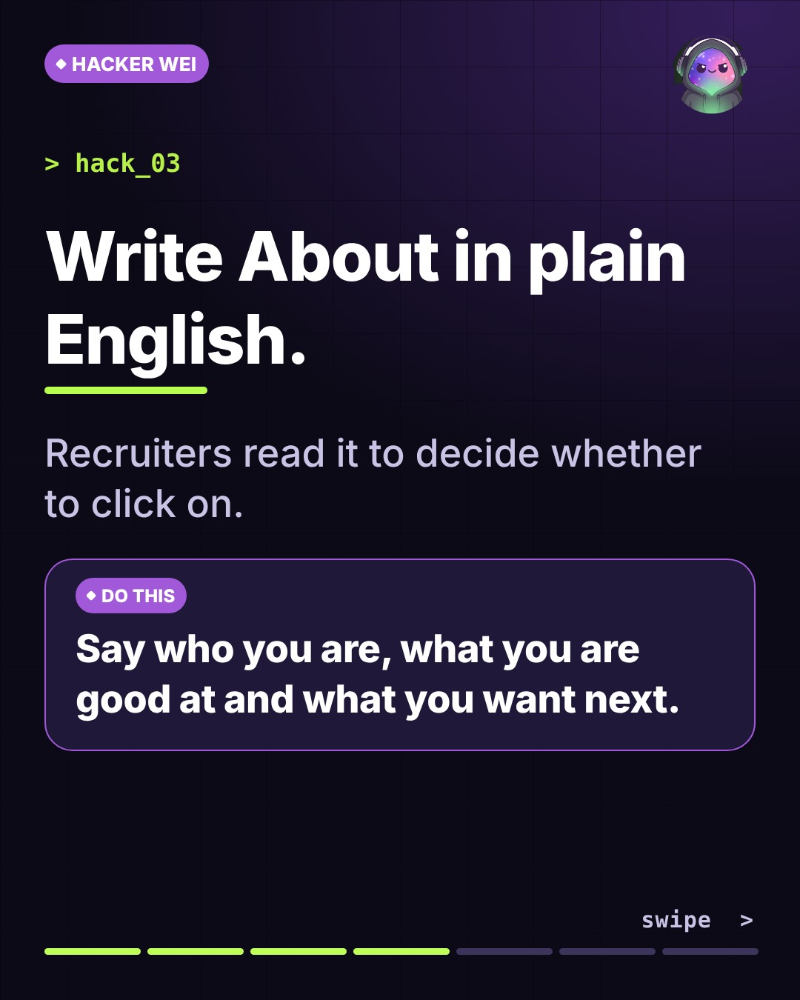</a> <a href="posts/008_5.jpg"></a> <a href="posts/008_6.jpg">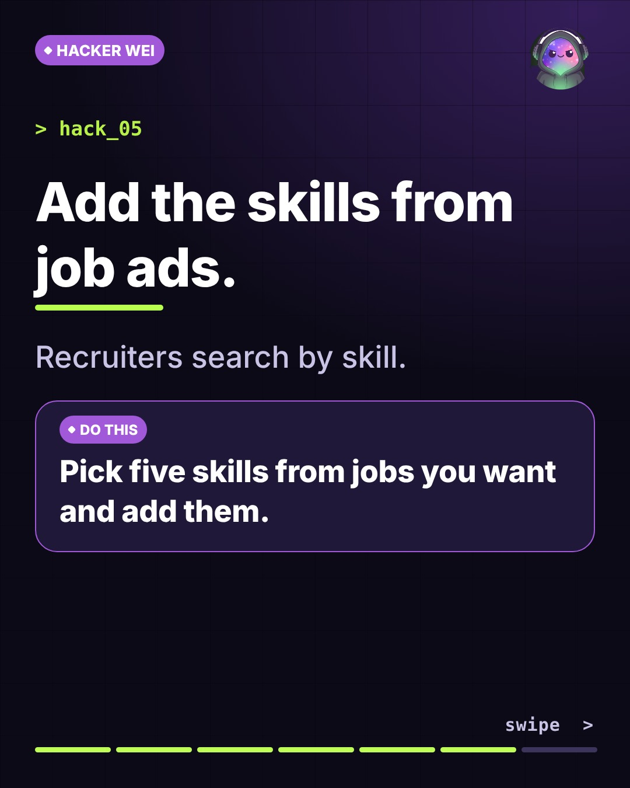</a> <a href="posts/008_7.jpg">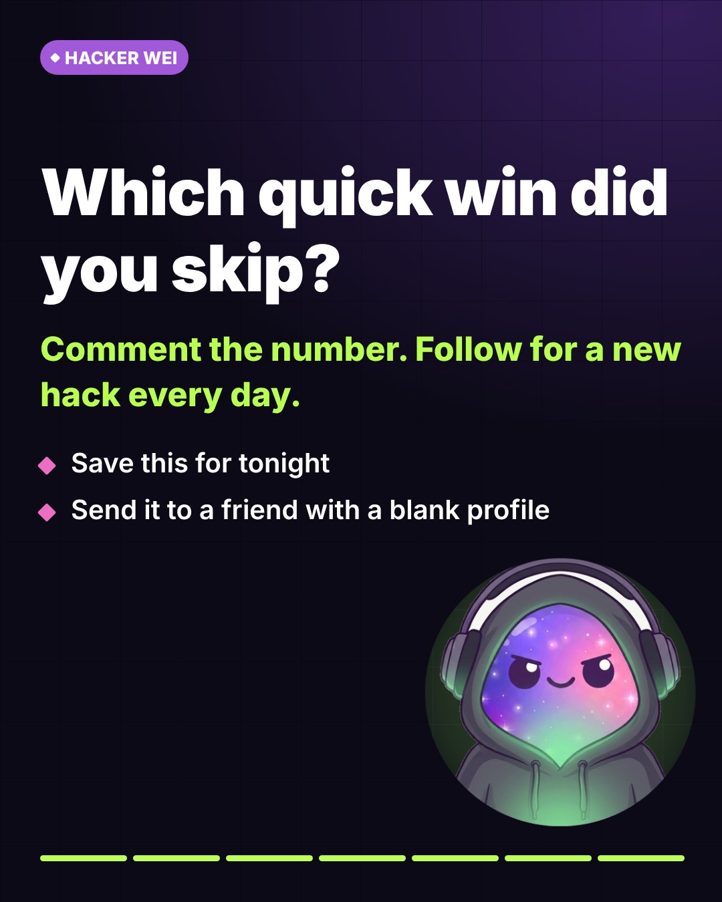</a>

<details><summary>Caption</summary>

```
Ten minutes is enough to make your LinkedIn work harder. 🔧

5 quick wins:
1. Write a clear headline
2. Add a clear, friendly photo
3. Write About in plain English
4. Turn on Open to work
5. Add the skills from job ads

Which quick win did you skip? Comment the number 👇
Save this for tonight and send it to a friend with a blank profile.

#linkedin #linkedintips #linkedinprofile #ukgraduate #graduatejobs #ukstudents #careeradvice #jobhunting #personalbranding #hackerwei
```

</details>

### 009

<a href="posts/009_1.jpg">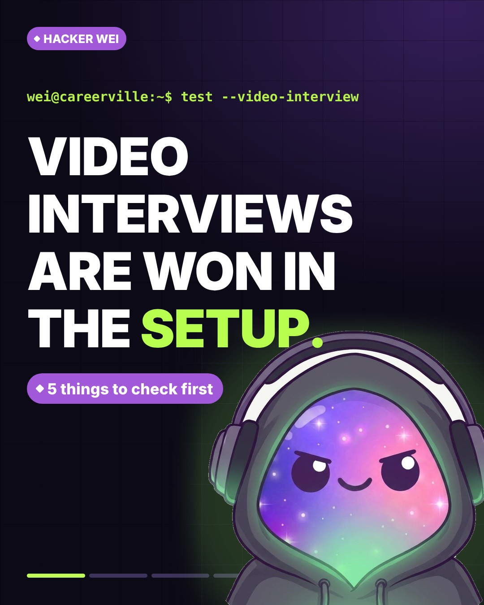</a> <a href="posts/009_2.jpg"></a> <a href="posts/009_3.jpg"></a> <a href="posts/009_4.jpg"></a> <a href="posts/009_5.jpg"></a> <a href="posts/009_6.jpg"></a> <a href="posts/009_7.jpg"></a>

<details><summary>Caption</summary>

```
Video interviews are won in the setup. 🎥

5 things to check first:
1. Test your tech the day before
2. Put the light in front of you
3. Look at the camera, not the screen
4. Keep notes where you can see them
5. Close tabs and silence notifications

Which one would you forget? Comment the number 👇
Save this before your interview.

#videointerview #interviewtips #zoominterview #ukgraduate #graduatejobs #ukstudents #careeradvice #jobinterview #interviewprep #hackerwei
```

</details>

### 010

<a href="posts/010_1.jpg">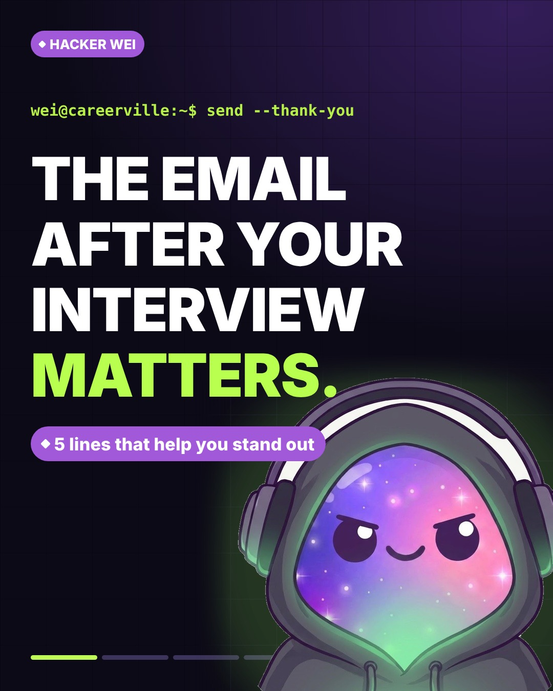</a> <a href="posts/010_2.jpg">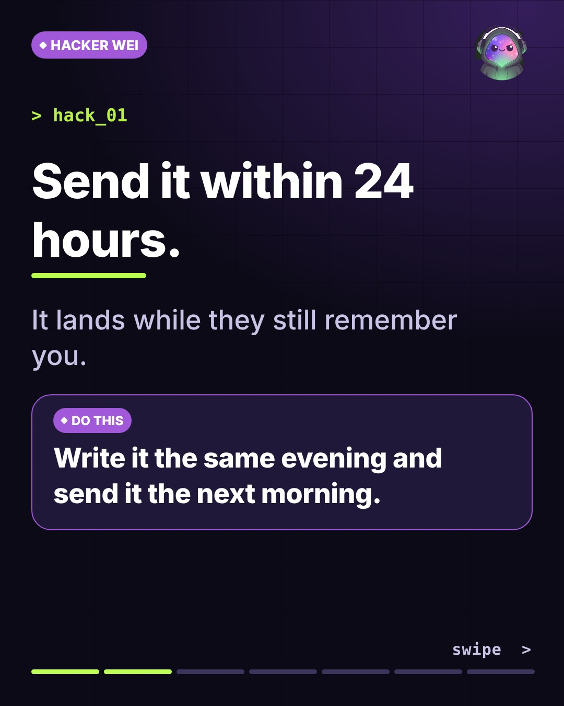</a> <a href="posts/010_3.jpg"></a> <a href="posts/010_4.jpg">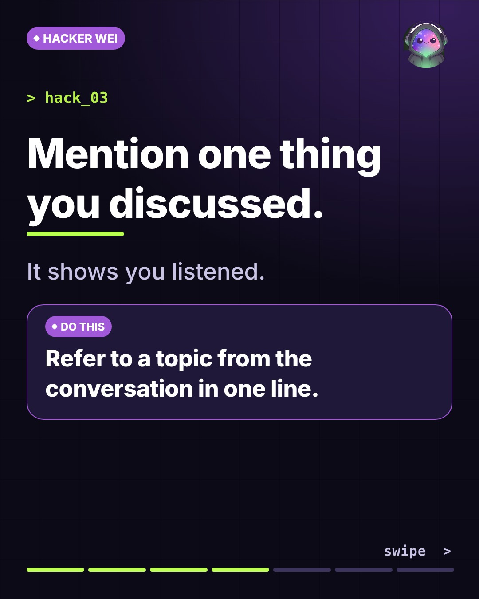</a> <a href="posts/010_5.jpg"></a> <a href="posts/010_6.jpg"></a> <a href="posts/010_7.jpg"></a>

<details><summary>Caption</summary>

```
The email after your interview matters more than you think. 📧

5 lines that help you stand out:
1. Send it within 24 hours
2. Thank them by name
3. Mention one thing you discussed
4. Restate why you want the role
5. Keep it short and warm

Did you send one last time? Comment the number 👇
Save this for after your interview.

#thankyouemail #interviewtips #followup #ukgraduate #graduatejobs #ukstudents #careeradvice #jobinterview #jobsearchuk #hackerwei
```

</details>

### 012

<a href="posts/012_1.jpg"></a> <a href="posts/012_2.jpg"></a> <a href="posts/012_3.jpg"></a> <a href="posts/012_4.jpg"></a> <a href="posts/012_5.jpg"></a> <a href="posts/012_6.jpg"></a> <a href="posts/012_7.jpg"></a>

<details><summary>Caption</summary>

```
Case studies at assessment centres are meant to test your thinking under pressure. Here is how to keep your cool.

5 hacks to stay clear:
1. Read the prompt twice
2. Prioritise the facts first
3. Manage your time strictly
4. Be ready to justify why
5. Stay focused on the prompt

Which hack will you use? Comment the number 👇
Save this and follow for a new hack every day.

#ukgraduate #graduatejobs #ukstudents #careeradvice #jobsearch #assessmentcentre #casestudy #interviewprep #jobinterview #hackerwei
```

</details>

### 013

<a href="posts/013_1.jpg"></a> <a href="posts/013_2.jpg"></a> <a href="posts/013_3.jpg"></a> <a href="posts/013_4.jpg">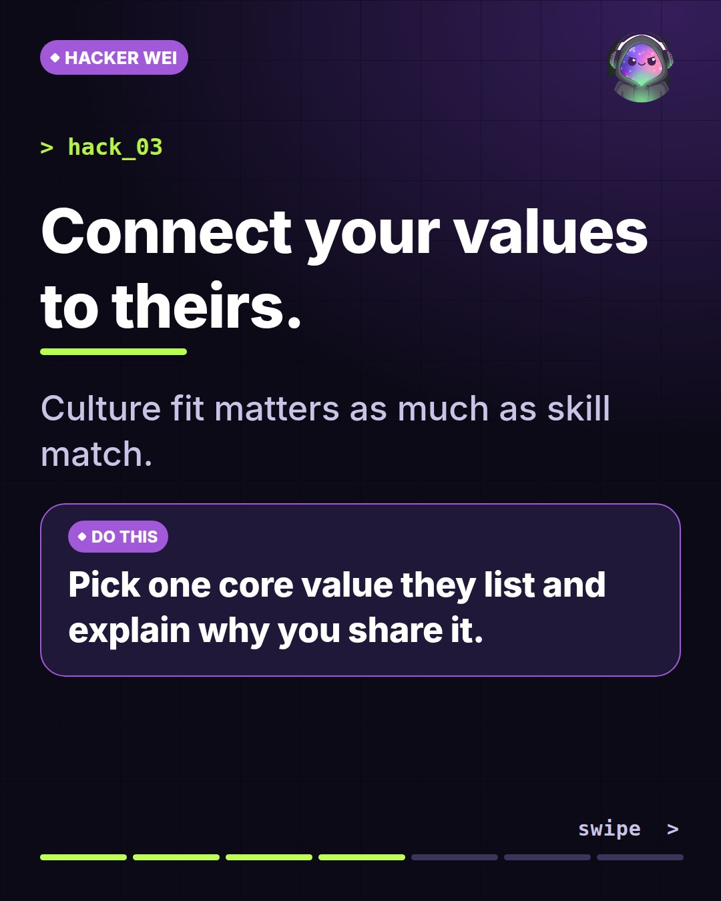</a> <a href="posts/013_5.jpg"></a> <a href="posts/013_6.jpg"></a> <a href="posts/013_7.jpg">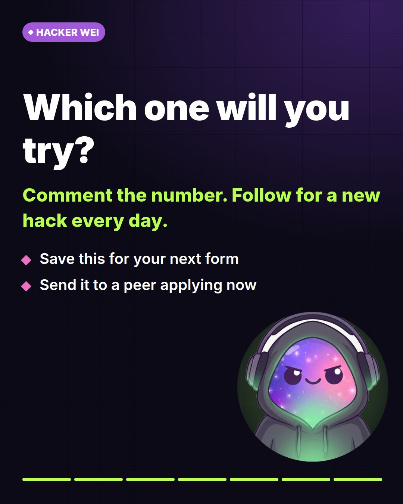</a>

<details><summary>Caption</summary>

```
Stop copying and pasting your motivation answers. Here is how to write a genuine response that actually gets noticed.

5 ways to write a better answer:
1. State your spark immediately
2. Link to their current projects
3. Connect your values to theirs
4. Keep the focus on them
5. Review your own examples

Which one will you try? Comment the number 👇
Save this and follow for a new hack every day.

#ukgraduate #graduatejobs #ukstudents #careeradvice #jobhunt #coverletter #applicationtips #jobapplication #graduatescheme #hackerwei
```

</details>

### 014

<a href="posts/014_1.jpg"></a> <a href="posts/014_2.jpg">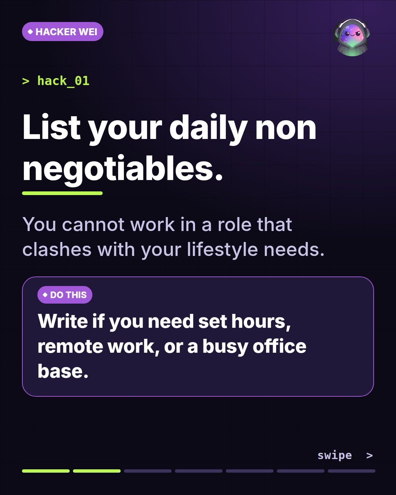</a> <a href="posts/014_3.jpg"></a> <a href="posts/014_4.jpg"></a> <a href="posts/014_5.jpg">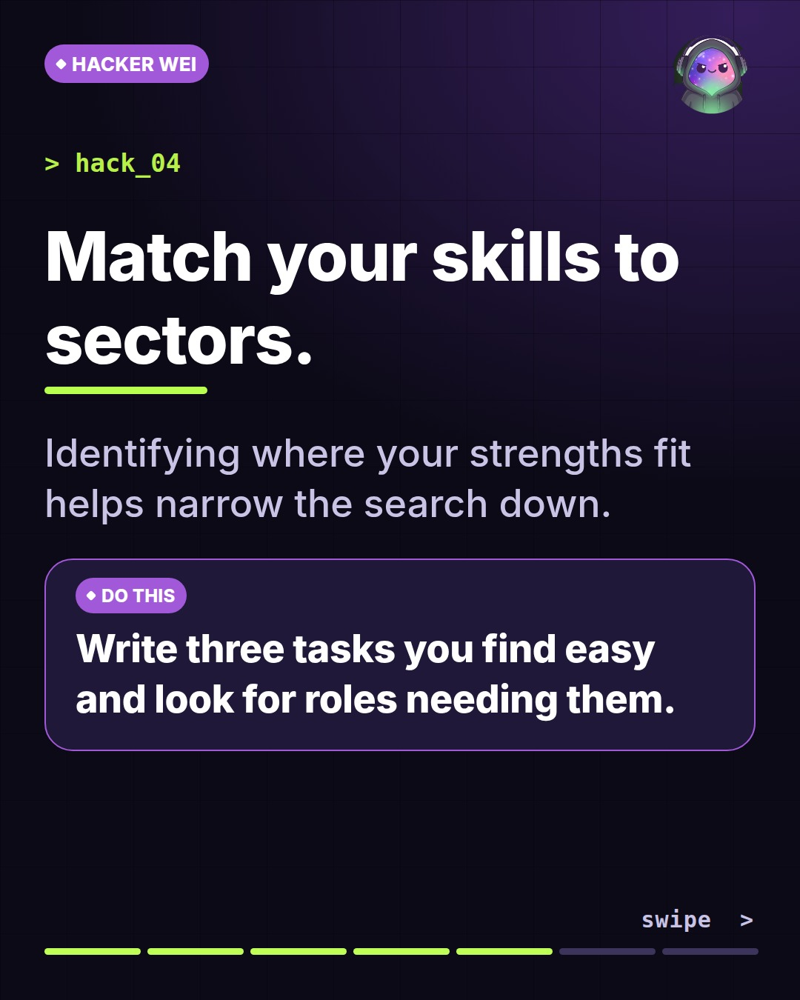</a> <a href="posts/014_6.jpg"></a> <a href="posts/014_7.jpg"></a>

<details><summary>Caption</summary>

```
Feeling lost after graduation is normal. Stop overthinking and start testing your way to a clear answer.

5 ways to find your path:
1. List your daily non negotiables
2. Check your search history
3. Shadow a professional for a day
4. Match your skills to sectors
5. Talk to a recent graduate

Which step will you try? Comment the number 👇
Save this and follow for a new hack every day.

#ukgraduate #graduatejobs #ukstudents #careeradvice #jobsearchuk #careergoals #careertips #graduatescheme #studentlife #hackerwei
```

</details>

### 015

<a href="posts/015_1.jpg"></a> <a href="posts/015_2.jpg"></a> <a href="posts/015_3.jpg">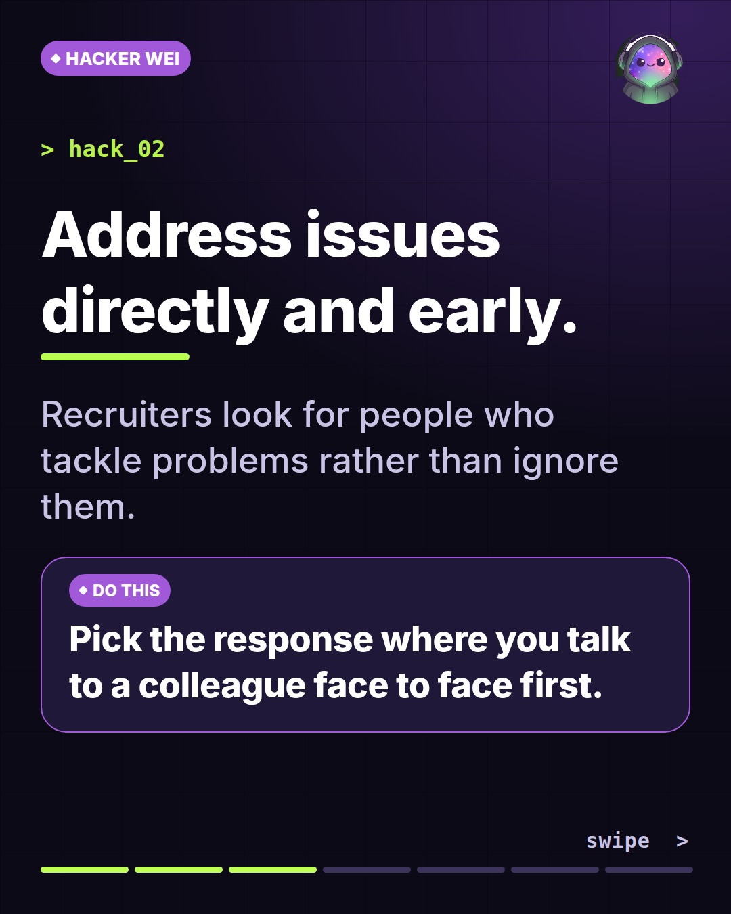</a> <a href="posts/015_4.jpg"></a> <a href="posts/015_5.jpg"></a> <a href="posts/015_6.jpg"></a> <a href="posts/015_7.jpg"></a>

<details><summary>Caption</summary>

```
Situational judgement tests can feel confusing. Here is how to pick the right answers and pass your next assessment.

5 rules for situational tests:
1. Put team goals before your own
2. Address issues directly and early
3. Never pass your duties upwards
4. Align choices with company values
5. Avoid extreme or blunt responses

Which rule will you use? Comment the number 👇
Save this and follow for a new hack every day.

#ukgraduate #graduatejobs #ukstudents #careeradvice #jobhunting #sjt #onlineassessment #psychometric #gradschemes #hackerwei
```

</details>

### 016

<a href="posts/016_1.jpg"></a> <a href="posts/016_2.jpg"></a> <a href="posts/016_3.jpg"></a> <a href="posts/016_4.jpg"></a> <a href="posts/016_5.jpg"></a> <a href="posts/016_6.jpg">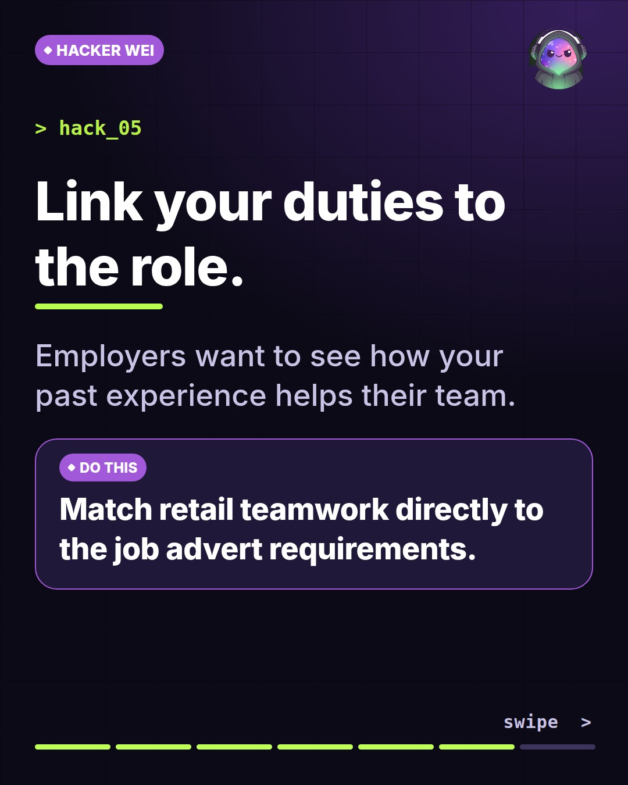</a> <a href="posts/016_7.jpg">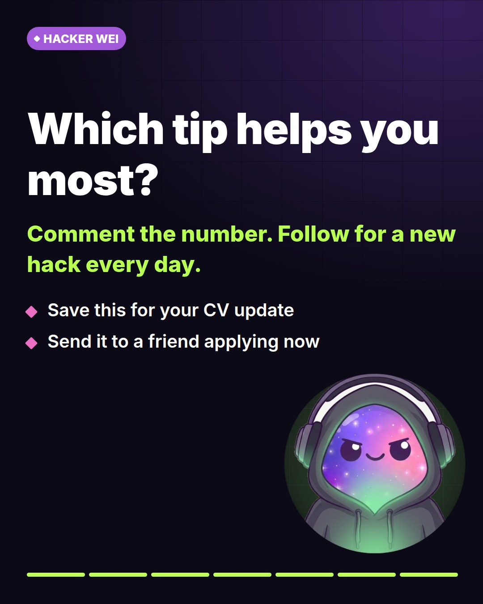</a>

<details><summary>Caption</summary>

```
Worked in retail or at a bar? Here is how to make your part-time uni job look impressive on a graduate CV.

5 ways to upgrade part-time work:
1. Lead with transferable skills
2. Show the scale of your work
3. Show trust and responsibility
4. Start bullets with action verbs
5. Link your duties to the role

Which tip helps you most? Comment the number 👇
Save this and follow for a new hack every day.

#ukgraduate #graduatejobs #ukstudents #careeradvice #jobhunting #cvtips #parttimejob #cvhelp #studentcv #hackerwei
```

</details>

### 017

<a href="posts/017_1.jpg"></a> <a href="posts/017_2.jpg"></a> <a href="posts/017_3.jpg"></a> <a href="posts/017_4.jpg"></a> <a href="posts/017_5.jpg"></a> <a href="posts/017_6.jpg"></a> <a href="posts/017_7.jpg">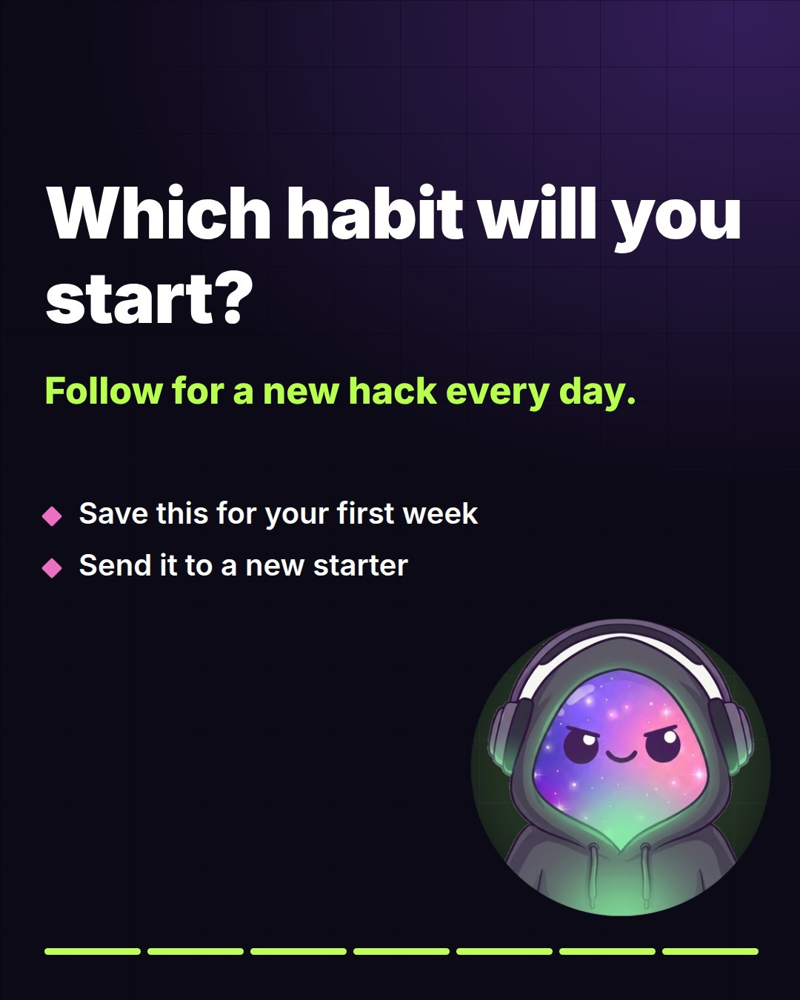</a>

<details><summary>Caption</summary>

```
Starting your first job can feel overwhelming. Here is how to nail your first week.

5 habits that make you look pro:
1. Write everything down
2. Set up your tech early
3. Ask questions in batches
4. Eat lunch with the team
5. Send a Friday recap

Which habit will you start? Comment the number 👇
Save this and follow for a new hack every day.

#ukgraduate #graduatejobs #ukstudents #careeradvice #jobhunting #graduatelife #firstjob #graduatescheme #officeetiquette #hackerwei
```

</details>

### 018

<a href="posts/018_1.jpg"></a> <a href="posts/018_2.jpg"></a> <a href="posts/018_3.jpg"></a> <a href="posts/018_4.jpg"></a> <a href="posts/018_5.jpg"></a> <a href="posts/018_6.jpg">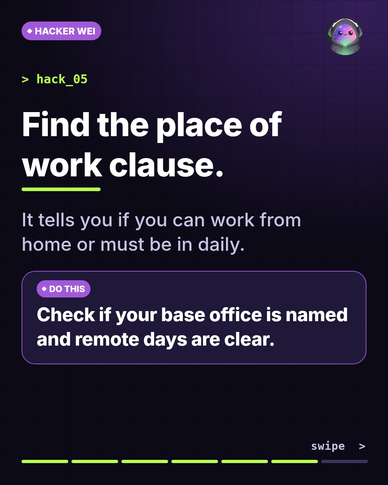</a> <a href="posts/018_7.jpg"></a>

<details><summary>Caption</summary>

```
An employment contract is more than just a starting date and a salary. Here is what to check before you sign.

5 clauses to check before you sign:
1. Check the probation period length
2. Look up notice period rules
3. Read the training repayment clause
4. Check the standard working hours
5. Find the place of work clause

Which clause will you check? Comment the number 👇
Save this and follow for a new hack every day.

#ukgraduate #graduatejobs #ukstudents #careeradvice #jobhunting #employmentlaw #graduatescheme #careerstart #jobsearchuk #hackerwei
```

</details>

### 019

<a href="posts/019_1.jpg"></a> <a href="posts/019_2.jpg"></a> <a href="posts/019_3.jpg"></a> <a href="posts/019_4.jpg"></a> <a href="posts/019_5.jpg">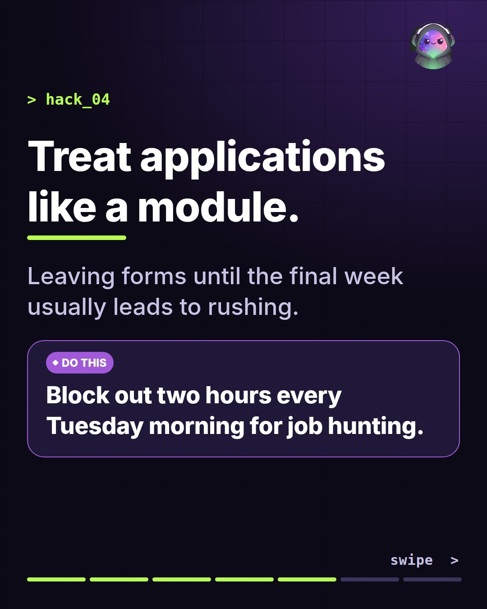</a> <a href="posts/019_6.jpg"></a> <a href="posts/019_7.jpg"></a>

<details><summary>Caption</summary>

```
Finding a placement year is tough when everyone else is applying too. Here is how to stand out.

5 ways to beat the rush:
1. Target mid sized local firms
2. Use your university careers hub
3. Direct message the recruitment team
4. Treat applications like a module
5. Practise recorded video interviews

Which one will you try? Comment the number 👇
Save this and follow for a new hack every day.

#ukgraduate #graduatejobs #ukstudents #careeradvice #jobhunting #placementyear #internship #unilife #jobsearchuk #hackerwei
```

</details>

## Pirate Wei

**1 waiting** (1 from the vault). 2 posted by the system so far.

### vault/20261120-1800-tt-carousel-emailstory-notenoughexperience

<a href="vault/pirate/20261120-1800-tt-carousel-emailstory-notenoughexperience_1.jpg">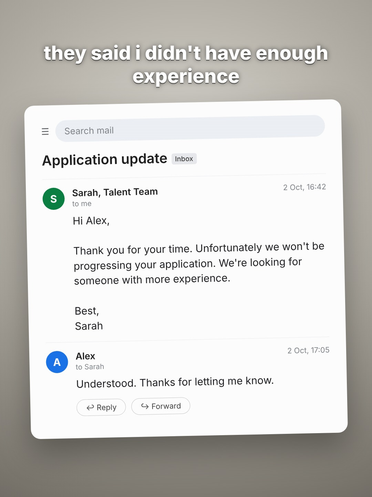</a> <a href="vault/pirate/20261120-1800-tt-carousel-emailstory-notenoughexperience_2.jpg"></a> <a href="vault/pirate/20261120-1800-tt-carousel-emailstory-notenoughexperience_3.jpg"></a> <a href="vault/pirate/20261120-1800-tt-carousel-emailstory-notenoughexperience_4.jpg">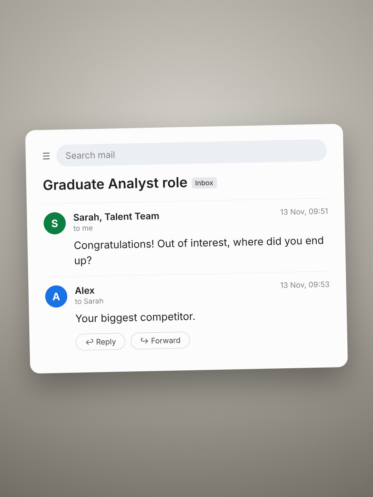</a> <a href="vault/pirate/20261120-1800-tt-carousel-emailstory-notenoughexperience_5.jpg"></a>

<details><summary>Caption</summary>

```
they said i didn't have enough experience

#jobsearch #rejection #emails #graduatejobs #corporatelife #storytime
```

</details>

## The Only Wei

**1 waiting** (1 from the vault). 1 posted by the system so far.

### vault/20261120-0730-tt-carousel-stevemartin-tenyears

<a href="vault/only/20261120-0730-tt-carousel-stevemartin-tenyears_1.jpg"></a> <a href="vault/only/20261120-0730-tt-carousel-stevemartin-tenyears_2.jpg">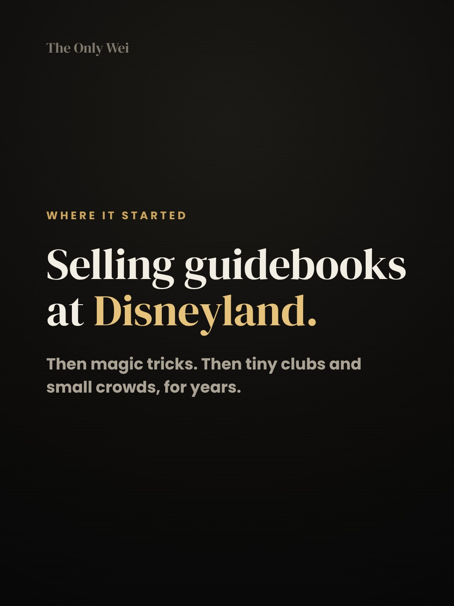</a> <a href="vault/only/20261120-0730-tt-carousel-stevemartin-tenyears_3.jpg">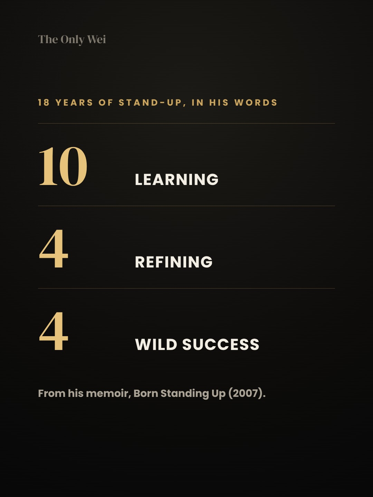</a> <a href="vault/only/20261120-0730-tt-carousel-stevemartin-tenyears_4.jpg">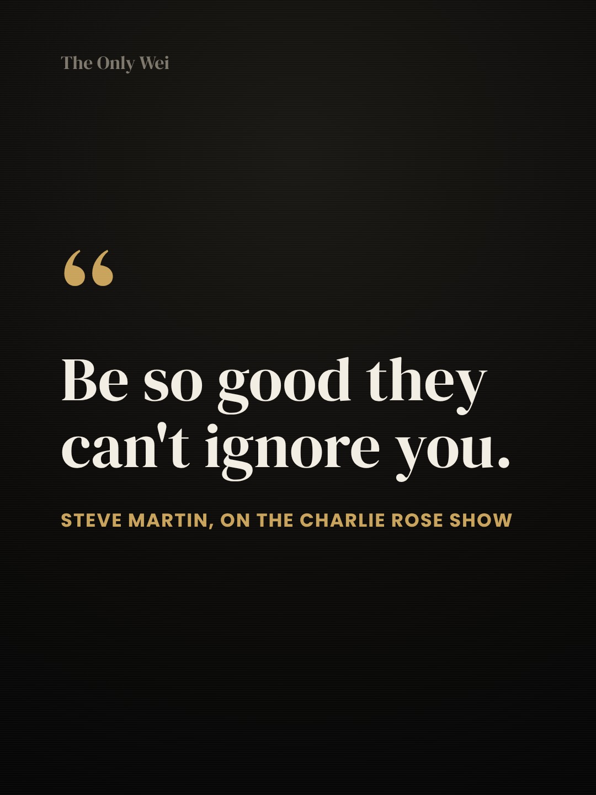</a> <a href="vault/only/20261120-0730-tt-carousel-stevemartin-tenyears_5.jpg">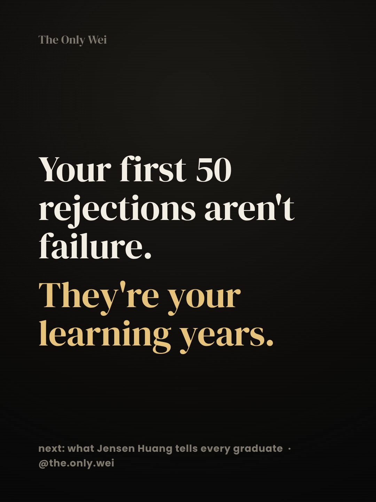</a>

<details><summary>Caption</summary>

```
it took him 10 years to get good. then everything changed.

#stevemartin #discipline #careeradvice #mindset #quotes #ukjobs
```

</details>

## You Are Unemployed

**0 waiting** (0 from the vault). 2 posted by the system so far.

Nothing waiting.

## Wei Stories

**0 waiting** (0 from the vault). 2 posted by the system so far.

Nothing waiting.

## Pathwei

**4 waiting** (4 from the vault). 0 posted by the system so far.

### vault/20261120-1000-tt-thepromotion

(video)

<details><summary>Caption</summary>

```
ego took the credit. obsession took the company.

#promotion #corporatelife #obsession #ego #motivation #careers
```

</details>

### vault/20261120-1230-tt-mostsuccessful-pt2-spain-amancioortega

(video)

<details><summary>Caption</summary>

```
every country's most successful person. part 2: spain

#amancioortega #zara #spain #success #mindset #careers
```

</details>

### vault/20261120-1800-ig-thepromotion

(video)

<details><summary>Caption</summary>

```
ego took the credit. obsession took the company.

#promotion #corporatelife #careers #motivation
```

</details>

### vault/20261120-1900-tt-founder-skit-newruleeveryweek

(video)

<details><summary>Caption</summary>

```
recruiters every single week with a new rule

#comedy #recruiters #work #jobs #skit #jobsearch
```

</details>

## Chef Wei

**0 waiting** (0 from the vault). 0 posted by the system so far.

Nothing waiting.

## Pathwei App

**0 waiting** (0 from the vault). 0 posted by the system so far.

Nothing waiting.

## Mr Pathwei

**0 waiting** (0 from the vault). 0 posted by the system so far.

Nothing waiting.

